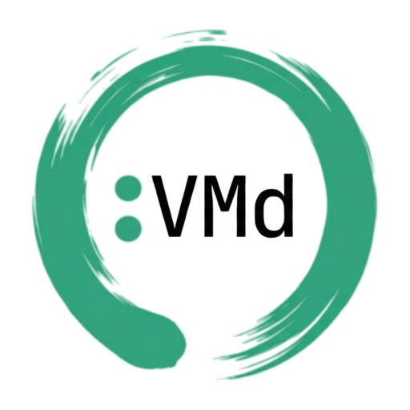
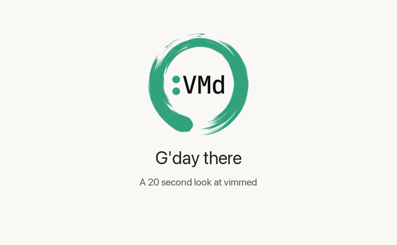

<p align="center">
  <picture>
    <source media="(prefers-color-scheme: dark)" srcset="docs/assets/logo-dark.png">
    <source media="(prefers-color-scheme: light)" srcset="docs/assets/logo-light.png">
    
  </picture>
</p>

# vimmed

[![CI][ci-badge]][ci]
[![Latest release][release-badge]][release]
[![OpenSSF Scorecard][scorecard-badge]][scorecard]
[![Coverage][coverage-badge]][coverage]
[![REUSE status][reuse-badge]][reuse]
[![Licence: MIT][licence-badge]](LICENSE)

A fast, keyboard-driven Markdown editor with vim keys, one window per file, for macOS and Linux.



It is MIT licensed: see `LICENSE`.

## Building

You need the Rust toolchain pinned in `rust-toolchain.toml` (rustup installs it on first use).
On Linux you also need the GTK 4 (4.14 or later) and fontconfig development files.

```sh
cargo build --release      # target/release/launcher and target/release/window
cargo xtask ci             # fmt, clippy, tests, the lints and the rename test
cargo xtask linux-check    # build, test and smoke run in the Linux container (needs Docker)
```

The binaries are built as `launcher` (the command you run) and `window` (the editor itself,
which the launcher starts). Packaging renames them.

## macOS install

On Apple silicon you can skip the build: download the `_macos_arm64.zip` asset from the latest
release on this repository's Releases page, unzip it and move the app to `/Applications`. The
app is signed with a Developer ID certificate and notarised by Apple, so it opens without a
Gatekeeper warning. `SECURITY.md` shows how to check the download's attestation and
notarisation. The command inside the app is `<BundleName>.app/Contents/MacOS/<name>`; link it
onto your `PATH` (for example into `~/.local/bin`) to open files from a terminal. There is no
Intel build: macOS 26 was the last release to support Intel Macs, so build from source there.

To build and install it yourself instead:

```sh
cargo xtask install-mac
```

This builds the release bundle (`cargo xtask bundle-mac --release`, which writes
`target/dist/<BundleName>.app`), copies it to `~/Applications/<BundleName>.app` (replacing an
older copy), and symlinks `~/.local/bin/<name>` to the launcher inside the bundle. Make sure
`~/.local/bin` is on your `PATH`, then open a file with `<name> notes.md`.

If `~/.local/bin/<name>` already exists as a regular file, the install stops rather than
replace it. Move it aside and run the command again.

## Linux packages

Packages are built with [cargo-deb](https://crates.io/crates/cargo-deb) 3.8.0 and
[cargo-generate-rpm](https://crates.io/crates/cargo-generate-rpm) 0.21.1. The check container
(`docker/Dockerfile.check`) has both. On a Linux machine, install them with:

```sh
cargo install --locked cargo-deb --version 3.8.0
cargo install --locked cargo-generate-rpm --version 0.21.1
```

Then:

```sh
cargo xtask package-linux
```

This builds the release binaries, stages them in `target/pkg/`, and writes the `.deb` and the
`.rpm` to `target/dist/`. Both install the same layout:

| File | Installed as |
|---|---|
| launcher | `/usr/bin/<name>` |
| window | `/usr/lib/<name>/<name>-window` |
| desktop entry | `/usr/share/applications/<bundle id>.desktop` |
| AppStream metainfo | `/usr/share/metainfo/<bundle id>.metainfo.xml` |
| app icon (32 to 512 px) | `/usr/share/icons/hicolor/<size>/apps/<bundle id>.png` |

The desktop entry runs `<name> -b %f`, so opening a Markdown file from a file manager starts a
detached window for it.

For Arch, `package-linux` also renders `target/pkg/arch/PKGBUILD` beside a source tarball of the
workspace's committed build inputs (the manifests, `.cargo/`, `crates/`, `xtask/` and
`packaging/`, which carries the icons) and the desktop and metainfo files. Build it there:

```sh
cd target/pkg/arch && makepkg -si
```

The PKGBUILD fetches the locked dependencies, builds with `cargo build --frozen --release` and
installs the layout above.

## Icons

The app icons and the logo above are made from two source images by `scripts/make-icons.sh`:
the logo with black text (for light backgrounds) and the logo with white text (for dark ones).

```sh
scripts/make-icons.sh LIGHT_SRC.png DARK_SRC.png
```

It writes `docs/assets/logo-light.png` and `docs/assets/logo-dark.png` (this README picks one by
the viewer's theme), `packaging/icons/AppIcon.icns` (copied into the `.app` by `bundle-mac`) and
`packaging/icons/hicolor/<size>/apps/app-icon.png` (installed by the Linux packages). Both app
icons use the white-text image: a `.icns` holds one image for every appearance, and the
freedesktop icon theme has no light and dark variants either. It needs ImageMagick 7 and, for
the `.icns`, macOS `iconutil`. Run it outside any sandbox, because `iconutil` writes temporary
files under `/var/folders`.

## Renaming

To rename the project, change the one line:

```toml
[workspace.metadata.app]
name = "new_name"
```

The slug must match `^[a-z][a-z0-9_]*$`. Then prove nothing still carries the old name:

```sh
cargo xtask rename-test             # binaries, plus the .app on macOS
cargo xtask rename-test --linux     # also the .deb, the .rpm and the PKGBUILD (needs Docker)
```

`rename-test` copies the tree to a scratch directory, renames it there to a throwaway name
(`--name SLUG` picks one), builds it, bundles and packages it, and searches every byte of the
results, including the unpacked contents of the `.deb` and the `.rpm`, for every form of the
current name. It passes with `0 hits` and the launcher's `--version` showing the throwaway
name. Nothing in the working tree changes, and no other file (this README included) needs an
edit when the name does.

## Contributing

To send a change, read [CONTRIBUTING.md](CONTRIBUTING.md). The hand checks to run before a release are in [docs/manual-checks.md](docs/manual-checks.md).

## Security

To report a vulnerability, follow [SECURITY.md](SECURITY.md).

## Licence

MIT, see [LICENSE](LICENSE). The bundled test fonts are under the SIL OFL 1.1:
[NotoSans](crates/editor-render/tests/fonts/NotoSans-OFL.txt),
[NotoSansMono](crates/editor-render/tests/fonts/NotoSansMono-OFL.txt) and
[NotoSansSymbols2](crates/editor-render/tests/fonts/NotoSansSymbols2-OFL.txt).

<!-- The badge URLs carry the project name, so they live here, the one
     README block that `cargo xtask lint-name` allows to. -->
<!-- name-lint:allow:start -->
[ci-badge]: https://github.com/bawdo/vimmed/actions/workflows/ci.yml/badge.svg?branch=main
[ci]: https://github.com/bawdo/vimmed/actions/workflows/ci.yml
[release-badge]: https://img.shields.io/github/v/release/bawdo/vimmed
[release]: https://github.com/bawdo/vimmed/releases/latest
[scorecard-badge]: https://api.scorecard.dev/projects/github.com/bawdo/vimmed/badge
[scorecard]: https://scorecard.dev/viewer/?uri=github.com/bawdo/vimmed
[coverage-badge]: https://codecov.io/gh/bawdo/vimmed/branch/main/graph/badge.svg
[coverage]: https://codecov.io/gh/bawdo/vimmed
[reuse-badge]: https://api.reuse.software/badge/github.com/bawdo/vimmed
[reuse]: https://api.reuse.software/info/github.com/bawdo/vimmed
[licence-badge]: https://img.shields.io/github/license/bawdo/vimmed
<!-- name-lint:allow:end -->
